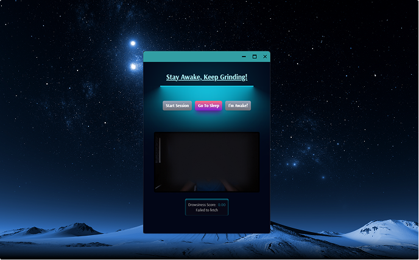

<h1 style="font-family: Arial, sans-serif; font-size: 36px;display: flex; align-items: center; border-bottom: 3px solid ; padding-bottom: 5px;">
  
  WAKEY-WAKEY - Desktop Alertness Companion
</h1>

<div align="center">
  
</div>

---

## 📌 Overview
WAKEY-WAKEY is a **desktop companion** designed to keep you **awake and alert**.
It uses your webcam and real-time facial-landmark analysis to detect drowsiness (eye closure, yawning), triggering **customizable audio alerts** when it does.

Perfect for students, professionals, night-shift workers, or anyone needing focus during long sessions.

---

## 🚀 Features
- **Real-Time Drowsiness Detection**: Tracks eye closure and yawns via facial landmarks (Eye Aspect Ratio / Mouth Aspect Ratio)
- **Smart Alert System**: Rotating audio notifications (`sound1`–`sound5.mp3`) triggered when drowsiness is detected
- **Non-Intrusive**: Runs quietly in the background with a system tray presence
- **Local Processing & Privacy**: Detection runs entirely in-app. Webcam frames never leave your device; the only network traffic is downloading the MediaPipe runtime and face model on first start
- **Scientific Detection**: EAR/MAR thresholds over MediaPipe FaceLandmarker output

---

## 🏗️ How detection works

Detection runs in the app itself through `@mediapipe/tasks-vision` (`src/lib/detector.ts`). Each webcam frame goes through MediaPipe's `FaceLandmarker` (GPU-delegated, WASM runtime), and the detector turns the landmarks into two numbers:

- **EAR** (eye aspect ratio), averaged over both eyes. It drops as the eyes close.
- **MAR** (mouth aspect ratio), from the inner lips. It rises during a yawn.

Both are normalised and combined into a drowsiness score, with eye closure weighted five times more than the mouth. A score above 0.7 counts as drowsy, which triggers the alert sound.

The WASM runtime is pinned to the same version as the npm package, since the two must match. Earlier versions used a separate Flask/Python service for inference; it was removed in August 2026, so there is no Python setup.

---

## 🛠️ Tech Stack

### **Detection**
 **MediaPipe Tasks Vision** – in-app face-landmark detection (replaces the old Python/Flask CV service)

### **Frontend**
 **React** – UI library
 **TypeScript** – detection/typing layer
 **Vite** – frontend build tool
 **Tailwind CSS** – utility-first styling
 **Motion** – smooth UI animations

### **Platform**
 **Tauri** – native desktop app packaging, tray icon, and shell/fs plugins

---

## 📁 Project Structure
```
src/
├── lib/
│   └── detector.ts        # In-app MediaPipe FaceLandmarker-based drowsiness detection
├── pages/                 # Home, Settings
├── components/            # Tray, Lamp, Video UI components
├── assets/sounds/          # Alert sounds (sound1..sound5.mp3)
public/
src-tauri/                 # Tauri native app configuration (tray, fs, shell)
vite.config.js
tailwind.config.js
```

---

## ⚙️ Installation

```sh
git clone https://github.com/mohaneddz/Waeky-Waeky
cd Waeky-Waeky
npm install
```

No Python setup is required anymore — the old Flask backend steps have been removed.

---

## 🚀 Development

```sh
npm run dev
```

Or run the full desktop shell:

```sh
npm run tauri dev
```

---

## 📦 Production Build

```sh
npm run build
npm run tauri build
```

---

## 🤝 Contributing

1. Fork the repo
2. Create a branch (`git checkout -b feature/amazing-feature`)
3. Commit your changes (`git commit -m "Add feature"`)
4. Push (`git push origin feature/amazing-feature`)
5. Open a Pull Request

---

## 📄 License

[](https://opensource.org/licenses/MIT)

Licensed under **MIT License** – see the [LICENSE](LICENSE) file.
